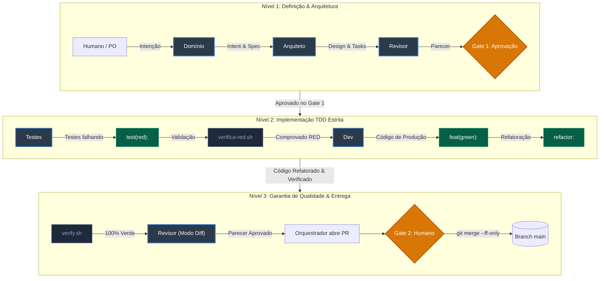

# Plataforma Corporativa de Tratativas e Planos de Ação (Action Plan)

[](https://cap.cloud.sap/)
[](test/)
[](.dependency-cruiser.cjs)
[](https://github.com/PauloCalazans/framework-sdlc-agentico)

> Plataforma corporativa desenvolvida para o ecossistema **SAP Business Technology Platform (BTP)** voltada à gestão ponta a ponta de tratativas e planos de ação hierárquicos, com auditoria estrita, notificações automatizadas, governança LGPD e integração analítica.
>
> **Nota de Destaque:** Além de conceber uma solução pronta para produção e de alta fidelidade técnica, o propósito central deste projeto foi **validar e comprovar a viabilidade de um Ciclo de Desenvolvimento de Software Agêntico (Agentic SDLC)** operando em um desenvolvimento iniciado do zero (*from scratch*). Toda a arquitetura, especificação e implementação foram guiadas pelo [Framework SDLC Agêntico](https://github.com/PauloCalazans/framework-sdlc-agentico).

## ⚡ Comece em 3 comandos

```bash
npm ci
for app in tratativas minhas-pendencias administracao launchpad; do npm install --prefix app/$app; done   # Git Bash, Linux, macOS
npm run watch
```

Abra **http://localhost:4004/br.com.calazanstec.actionplan.launchpad/index.html#Tratativa-manage** e clique em **Iniciar**. Você entra como `superusuario` (todos os papéis), sem login, sobre uma massa de demonstração com 31 tratativas. O passo a passo completo está na [seção 5](#5-como-rodar-localmente).

---

## 1. Contexto do Projeto e Arquitetura

### 1.1 Contexto de Negócio
Em operações corporativas (como Saúde e Segurança Ocupacional - SESMT, Qualidade, Compliance, RH, Sustentabilidade), desvios e incidentes são reportados em múltiplos aplicativos especialistas. Historicamente, essas origens criavam planos de ação isolados, sem rastreabilidade, prazos padronizados ou governança centralizada.

A plataforma inverte essa fragmentação estabelecendo o conceito de **Tratativa Central**:
```text
[Aplicativo de Origem + Registro Externo] ──(API v1 / OData v4)──► [Tratativa] 
                                                                  │
                ┌───────────────────┬─────────────────────────────┼─────────────────────────┐
                ▼                   ▼                             ▼                         ▼
        [Ações & Subações]     [Evidências]            [Comentários & Menções]    [Histórico Imutável]
        (Hierarquia 2 níveis)  (Upload / Extensões)    (Auditoria & Colaboração)  (Trilha de Auditoria)
```

- **Abertura Desacoplada e Idempotente:** Aplicativos externos integram via credenciais técnicas de aplicativo com idempotência por par `(origem, idOrigem)`. Chamar repetidamente a API retorna a tratativa já existente sem duplicidade.
- **Genericidade por Princípio:** Nenhuma regra ou nomenclatura de área (ex: "SESMT", "acidente", "advertência") é embutida no código. Toda especialização decorre de parametrização de dados (prazos por criticidade, templates e matrizes de risco).
- **Tratativas Avulsas:** Abertura direta por gestores para ocorrências sem sistema de origem prévio.
- **LGPD e Auditoria:** Registros de histórico imutáveis com mascaramento dinâmico de dados pessoais sensíveis conforme papéis de acesso.

---

## 2. Stack Tecnológica

| Camada | Tecnologia | Detalhes |
|---|---|---|
| **Backend Core** | SAP CAP (`@sap/cds` v10) | Node.js + TypeScript com tipagem estrita gerada pelo `@cap-js/cds-typer`; serviços expostos no **protocolo OData v4** com versionamento de endpoints em `/api/<serviço>/v1/` |
| **Banco de Dados (Produção)** | SAP HANA Cloud | Tabelas gerenciadas via SAP HANA Deployment Infrastructure (HDI) Container |
| **Banco de Dados (Local/Testes)** | SQLite em memória | Execução ultrarrápida e determinística com `@cap-js/sqlite` e `cds.test` |
| **Frontend / UI** | SAP Fiori Elements / UI5 | 3 Apps orientados a anotações CDS (`app/tratativas`, `app/minhas-pendencias`, `app/administracao`) para SAP Build Work Zone |
| **Launchpad Local** | Fiori Launchpad Sandbox | Sandbox UShell nativo (`app/launchpad/`) provido por `cds-plugin-ui5` sob a mesma origem |
| **Segurança / Auth** | SAP BTP XSUAA | Escopos, Role Templates e Role Collections configurados em `xs-security.json` com RBAC e mock de desenvolvimento (`auth-dev.js`) |
| **Integrações Externas** | SAP SuccessFactors | OData somente leitura para estruturas organizacionais e colaboradores (com cache local e resiliência) |
| **Notificações** | E-mail e Microsoft Teams | Motor de regras de alerta e despacho desacoplado por adaptadores idempotentes |
| **Qualidade & Linting** | Jest + ESLint + CDS Lint | Suíte contínua de testes automatizados (fumaça, unidade, integração e regressão); regras customizadas de genericidade de domínio |
| **Governança Arquitetural** | Dependency Cruiser | Validação estrita de fronteiras (`depcruise`) impedindo acoplamento indevido entre camadas |
| **Build & Empacotamento** | Cloud MTA (`mta.yaml`) | Multi-Target Application para deploy conteinerizado no SAP BTP Cloud Foundry |

---

## 3. O Experimento: Validação do SDLC Agêntico

O objetivo central deste repositório foi provar na prática como equipes de desenvolvimento compostas por agentes autônomos de IA — orquestrados sob governança determinística — podem entregar um produto corporativo complexo, do scaffold inicial à prontidão para deploy corporativo.

O processo e seus mecanismos foram derivados e parametrizados a partir do repositório:
👉 **[https://github.com/PauloCalazans/framework-sdlc-agentico](https://github.com/PauloCalazans/framework-sdlc-agentico)**

### 3.1 Princípios Invioláveis do Processo
1. **Prompt orienta, mecanismo controla:** Instruções em texto não bastam; a integridade é assegurada por scripts determinísticos (`verify.sh`, `verifica-red.sh`, `verifica-escopo.sh`), linters e githooks.
2. **Erro repetido vira mecanismo:** Desvios reincidentes geram validações mecânicas no repositório, nunca apenas avisos em prosa.
3. **Estado derivado:** O progresso do projeto nunca é anotado manualmente; é calculado em tempo de execução via `status-projeto.sh` e histórico Git.
4. **Afirmações técnicas são medidas:** Nenhuma funcionalidade é considerada pronta sem evidência registrada de execução e teste verde.
5. **O agente nunca integra:** O merge na branch principal (`main`) e a gestão de permissões de segurança são prerrogativas exclusivas do humano (Gate 2 humano sem squash).
6. **TDD Estrito (RED -> GREEN -> REFACTOR):** Commits obrigatórios `test(red):` comprovadamente falhando isoladamente, seguidos por `feat(green):` e `refactor:`.

### 3.2 Personas e Time Agêntico

O framework adota uma abordagem estritamente **agnóstica a modelos e provedores de IA**. A governança e a integridade do código residem nos contratos de papéis (`agentic/processo/papeis/`) e nos mecanismos de verificação determinística, permitindo que diferentes LLMs e ferramentas sejam combinados e alternados dinamicamente ao longo das fases:

| Persona | Papel | Perfil / Capacidade do Agente | Responsabilidade no Ciclo |
|---|---|---|---|
| **Humano** | Product Owner & Approver | Soberania de Decisão | Definição de estratégia, validação final de conformidade e aprovação exclusiva de merge no **Gate 2**. |
| **Orquestrador** | Conductor de Sessão *(Hub: Maestri)* | Coordenação e Contexto Multiferramenta | Leitura do estado derivado, despacho de briefs por worktrees isolados, sincronização entre ferramentas e emissão de Rulings. |
| **Domínio (`dominio`)** | Analista de Negócios | Engenharia de Requisitos | Elaboração de `intent.md` e `spec.md`, estruturação de questionários de decisão e refinamento de regras. |
| **Arquiteto (`arquiteto`)** | Engenheiro de Software | Raciocínio Arquitetural Profundo | Elaboração de `design.md`, identificação de itens N3 de risco, contratos de API e quebra em tasks atômicas. |
| **Testes (`testes`)** | Especialista TDD / QA | Precisão e Rigor em Testes | Criação dos cenários de teste automatizados, garantindo falha prévia (`test(red):`) sem tocar no código de produção. |
| **Dev (`dev`)** | Engenheiro de Software | Construção e Refatoração de Código | Implementação da solução mínima para aprovação dos testes (`feat(green):`) e melhorias arquiteturais (`refactor:`). |
| **Revisor (`revisor`)** | Code Reviewer Independente | Ceticismo e Análise Crítica | Avaliação cética de specs, designs e diffs, classificando achados em Crítico, Importante ou Menor. |

> **Orquestração e Interoperabilidade de Produtos:**  
> O papel do **Orquestrador** pode ser exercido tanto diretamente pelo próprio *harness* de execução local (ex.: sessões CLI de agentes) quanto por ferramentas especializadas de orquestração e canvas multiagente, como o **Maestri** (utilizado como hub central neste projeto) ou o **Orca**.  
> 
> A grande vantagem de adotar uma ferramenta de orquestração além do harness individual é possibilitar o **uso integrado de múltiplos produtos de mercado**, e não apenas alternar modelos de LLM via API:
> - Ao longo deste desenvolvimento, diferentes produtos operaram simultaneamente sobre o mesmo repositório — incluindo **Claude Code** (atuando como orquestrador principal e, em momentos do ciclo, como dev, testes e revisor), **Kiro CLI**, **Antigravity**, **GitHub Copilot** e **OpenCode (DeepSeek)**.
> - Essa colaboração heterogênea é viabilizada com segurança porque o controle de qualidade e a sincronização não dependem das interfaces proprietárias dos agentes, mas sim dos **mecanismos mecânicos do repositório** (`verify.sh`, `verifica-red.sh`, `verifica-escopo.sh`) e do **isolamento estrito de branches e worktrees** do git.

### 3.3 Fluxo de Trabalho Integrado (Mermaid)



---

## 4. Estrutura do Repositório

```text
action-plan/
├── agentic/                  # Framework SDLC Agêntico
│   ├── mecanismos/scripts/   # Scripts de controle determinístico (verify.sh, verifica-red.sh, etc.)
│   ├── processo/             # Ciclos de desenvolvimento, princípios e contratos dos papéis
│   └── projeto/              # Artefatos produzidos (intent/, specs/, decisoes.md)
├── app/                      # Aplicações SAP Fiori Elements / UI5
│   ├── administracao/        # Gestão de parametrizações, prazos e credenciais técnicas
│   ├── launchpad/            # Fiori Launchpad Sandbox unificado (UShell)
│   ├── minhas-pendencias/    # Visão simplificada para responsáveis operacionais
│   ├── tratativas/           # Gestão completa de ocorrências e planos de ação
│   └── services.cds          # Anotações e conexões centrais de UI Fiori
├── db/                       # Modelo de Domínio CDS (Persistência)
│   ├── data/                 # Cargas iniciais de parametrização (.csv)
│   ├── schema.cds            # Importações centrais
│   └── tratativa.cds         # Entidades centrais: Tratativas, Ações, Evidências, Histórico
├── srv/                      # Serviços OData e Handlers TypeScript
│   ├── administracao-service.ts  # Gestão de credenciais, templates e prazos
│   ├── analitico-service.ts      # Vistas analíticas para SAC / Power BI
│   ├── integracao-origem-service.ts # Endpoint público desacoplado para apps de origem
│   ├── integracao-pessoas-service.ts # Consulta e sincronização com SuccessFactors
│   ├── tratativa-app-service.ts  # Serviço de consumo otimizado das UIs Fiori
│   └── tratativa-service.ts      # Núcleo de regras de negócio, bloqueios e transições
├── test/                     # Suíte de Testes Automatizados (Jest + cds.test)
│   ├── apoio/                # Dublês de teste, espiões de storage, SF, banco e auth-dev.js
│   ├── demo/                 # Dados de demonstração (só no perfil de desenvolvimento) e roteiro guiado
│   └── *.test.ts             # Suítes de testes unitários e de integração (100% verdes)
├── .dependency-cruiser.cjs   # Regras de arquitetura e fronteiras de dependência
├── eslint.config.mjs         # Configuração de ESLint e regras de genericidade
├── jest.config.js            # Configuração do executor Jest
├── mta.yaml                  # Descritor de deploy Multi-Target Application BTP
└── xs-security.json          # Descritor de segurança XSUAA e RBAC
```

---

## 5. Como Rodar Localmente

Localmente o projeto roda como no SAP Business Application Studio: `cds watch` + `cds-plugin-ui5` + Fiori Launchpad sandbox, tudo na mesma origem, com SQLite em memória e **sem login**. O app trabalha com autorização por papéis; quem autentica em produção é o Launchpad (SAP Build Work Zone).

### 5.1 Pré-requisitos

- **Node.js 20 ou superior** (validado no Node.js 24) e npm 10 ou superior.
- **Git Bash** no Windows, só para os scripts de verificação (`verify.sh`).

### 5.2 Instalar

```bash
npm ci                                    # backend, CAP e ferramentas
npm install --prefix app/tratativas       # cada app Fiori tem suas dependências de build UI5
npm install --prefix app/minhas-pendencias
npm install --prefix app/administracao
npm install --prefix app/launchpad
```

> Sem a instalação dos apps, o servidor sobe mas o launchpad não carrega as aplicações.

### 5.3 Subir

```bash
npm run watch
```

Quando aparecer `server listening on { url: 'http://localhost:4004' }`, abra o launchpad:

| Aplicação | Endereço |
|---|---|
| 🚀 **Launchpad** (página inicial com os blocos) | http://localhost:4004/br.com.calazanstec.actionplan.launchpad/index.html |
| 📋 **Gestão de Tratativas** | http://localhost:4004/br.com.calazanstec.actionplan.launchpad/index.html#Tratativa-manage |
| 👤 **Minhas Pendências** | http://localhost:4004/br.com.calazanstec.actionplan.launchpad/index.html#MinhasPendencias-display |
| ⚙️ **Administração da Plataforma** | http://localhost:4004/br.com.calazanstec.actionplan.launchpad/index.html#AdministracaoPlataforma-manage |

- As listas **não carregam sozinhas**: clique em **Iniciar** na barra de filtros.
- A primeira abertura leva de 20 a 30 segundos, enquanto o servidor monta as bibliotecas UI5. As seguintes são imediatas.
- Abra os apps sempre pelo launchpad, com o `#` da navegação. O `index.html` de cada app, sem o hash, não abre a aplicação.

### 5.4 Dados de demonstração

O `npm run watch` já carrega uma massa fictícia de uma indústria com 4 unidades: **31 tratativas** de junho a outubro de 2026 em todos os status e criticidades, 55 ações e subações, evidências com arquivos que podem ser baixados, comentários, histórico, Avales Técnicos, metodologias de causa raiz, templates e alertas.

👉 O **roteiro guiado para avaliação**, com 8 cenários, está em [`test/demo/README.md`](test/demo/README.md).

Esses dados ficam em `test/demo/` e só existem no perfil de desenvolvimento. Os testes automatizados e a produção não os enxergam.

> `npm run start:local` (`cds serve --in-memory`) sobe o servidor **sem** a massa de demonstração e sem recarregamento automático. Para avaliar a solução, use `npm run watch`.

### 5.5 Personas

Não há tela de login: a identidade vem da variável `DEV_USER`, lida pelo middleware de desenvolvimento [`test/apoio/auth-dev.js`](test/apoio/auth-dev.js). Sem ela, você entra como **`superusuario`**, que tem todos os papéis.

```bash
DEV_USER=M1001 npm run watch              # Git Bash, Linux, macOS
$env:DEV_USER="M1001"; npm run watch      # PowerShell
```

| Persona | Papéis | Para ver |
|---|---|---|
| `superusuario` *(padrão)* | todos | Tudo: os três apps e os indicadores |
| `gestor` | GestorTratativa | Gestão completa das tratativas, sem máscara |
| `admin` | Administrador | Prazos, credenciais, templates e parâmetros |
| `validador` / `validador-b` | ValidadorTecnico | Emissão de Aval Técnico |
| `leitor-analitico` | LeitorAnalitico | Indicadores em `/api/analitico/v1` |
| `M1001` / `M2002` / `usuario` | nenhum | Minhas Pendências e a máscara LGPD de quem não é gestor |
| `app-origem-a` | AplicativoOrigem | Chamadas de um aplicativo de origem à API de integração |

### 5.6 APIs

Com o servidor no ar, http://localhost:4004/ lista todos os serviços (OData v4, versionados em `/api/<serviço>/v1/`):

| Serviço | Caminho |
|---|---|
| Núcleo de regras das tratativas | `/api/tratativa/v1/` |
| Serviço das telas Fiori | `/api/app/v1/` |
| Integração com aplicativos de origem | `/api/integracao-origem/v1/` |
| Administração | `/api/administracao/v1/` |
| Indicadores (SAC / Power BI) | `/api/analitico/v1/` |
| Pessoas (SuccessFactors, dublê local) | `/api/integracao-pessoas/v1/` |

**Exemplo: abertura idempotente por um aplicativo de origem.** Suba o servidor como o aplicativo (`DEV_USER=app-origem-a npm run watch`) e chame:

```bash
curl -X POST http://localhost:4004/api/integracao-origem/v1/abrirTratativa \
  -H "Content-Type: application/json" \
  -d '{
    "origem": "Inspeção de Segurança",
    "idOrigem": "INSP-2026-0999",
    "titulo": "Piso escorregadio na entrada do refeitório",
    "descricao": "Vazamento do bebedouro deixa o piso molhado",
    "criticidade": "Alta",
    "unidade": "Planta Betim",
    "area": "Facilities",
    "solicitante": "M1001"
  }'
```

A resposta traz o `codigo` da tratativa. Repetir a chamada com o mesmo par `origem` + `idOrigem` devolve **o mesmo código**, sem duplicar.

### 5.7 Testes e Verificação

| Comando | O que faz |
|---|---|
| `npm test` | Suíte completa (Jest + `cds.test` + SQLite em memória), cerca de 1 minuto |
| `npm run arch` | Fronteiras de arquitetura com `dependency-cruiser` |
| `npm run lint` | ESLint, incluindo as regras de genericidade de domínio |
| `sh agentic/mecanismos/scripts/verify.sh` | Verificação canônica do framework: testes, arquitetura, escopo, testes pulados e prova de RED |
| `npm run build` | Tipagem (`cds-typer` + `tsc`) e build de produção (`cds build --production`) |

---

## 6. Governança e Contribuição

Todo e qualquer ciclo de modificação de código neste repositório deve respeitar as diretrizes de governança agêntica:
- Não realize commits diretos na branch principal (`main`).
- Todo novo requisito exige especificação prévia em `agentic/projeto/intent/` e `agentic/projeto/specs/`.
- Qualquer alteração de comportamento deve possuir evidência comprovada através do ciclo TDD (`test(red):` -> `feat(green):`).
- Dúvidas arquiteturais e decisões permanentes estão registradas em [`agentic/projeto/decisoes.md`](agentic/projeto/decisoes.md).
